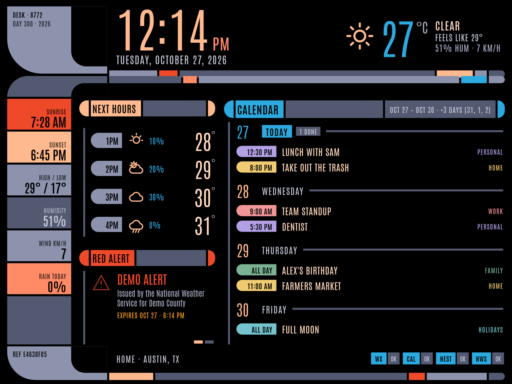
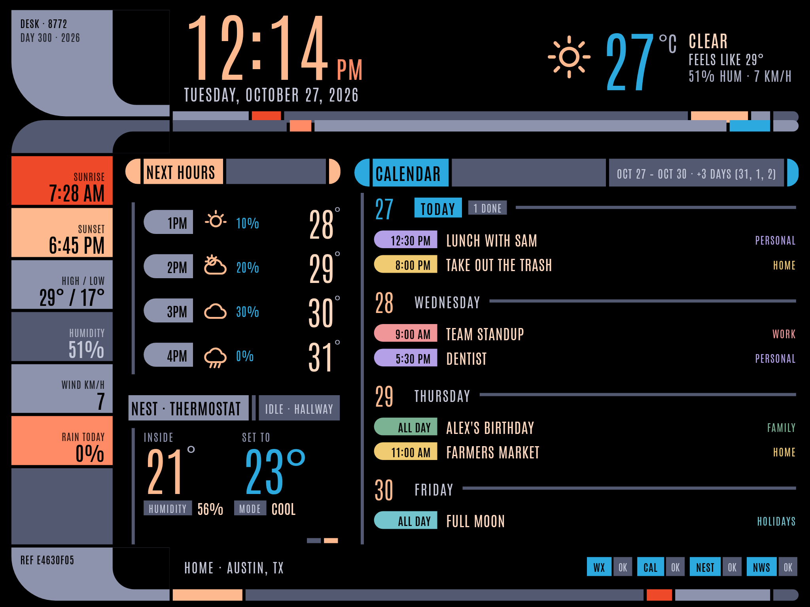

# iPad Desk Monitor

Tablero de escritorio con **tema LCARS** (Star Trek), pensado para quedarse prendido
en un iPad junto al escritorio. Lo sirve una máquina Linux de la casa (Python
estándar, sin dependencias) y el iPad solo abre una URL.





> Las capturas están hechas con `--mock` (datos de ejemplo). No traen datos
> reales de nadie.

## Qué trae

- **Marco LCARS**: codos, barras segmentadas y encabezados tipo píldora sobre negro,
  con fuente Antonio. Paleta: pizarra `#535970`, `#8d93ad`, rojo-naranja `#ee4a2a`,
  salmón `#ff8a66`, durazno `#ffb98e` y cian `#2ca9df`.
- **Reloj grande + fecha** del día, en la zona horaria configurada.
- **Avisos oficiales del NWS** (api.weather.gov) en una tarjeta que **rota cada 5
  minutos con el termostato Nest**, sincronizada al reloj. Sin alerta activa, la
  tarjeta se queda en el Nest y esconde los puntos de paginación. Con alerta, la
  píldora pasa a `RED ALERT` en rojo y el icono parpadea.
- **Clima ahora**: temperatura en °C, icono, sensación térmica, descripción,
  humedad y viento (Open-Meteo, sin API key).
- **Barra lateral**: amanecer, atardecer, máxima/mínima, humedad, viento y lluvia
  del día.
- **Próximas 4 horas** con icono, probabilidad de lluvia y temperatura.
- **Calendario vertical** a toda la altura de la columna, leyendo los **feeds
  iCal privados** de cada calendario (sin OAuth). La hora va en una píldora con
  el color de su calendario. **Los eventos que ya terminaron salen de la pila**
  (el encabezado del día dice `N DONE`), el que está en curso queda arriba con
  `· NOW`, y el espacio que se libera lo ocupa el **avance del día siguiente**.
- **Termostato Nest** por Google Device Access (SDM): ambiente, set point,
  humedad, modo y estado.
- **Pie de estado**: una píldora por fuente (`WX`, `CAL`, `NEST`, `NWS`) que pasa a
  ámbar si el dato está viejo y a rojo si la fuente se cae.
- Cero librerías de frontend. (El diseño anterior, con fondos rotativos y Inter,
  vive en el historial de git; el servidor todavía publica la lista de fondos.)

## Arranque rápido

```bash
git clone https://github.com/ElChacoVeloz/ipad-monitor.git
cd ipad-monitor
cp config.example.json config.json     # ajusta coordenadas, TZ y puerto
python3 server.py --port 8772          # http://localhost:8772
```

Para verlo sin credenciales: `python3 server.py --mock --port 8772`.
Para depurar el JSON: `python3 server.py --once`.

## Cómo está hecho

- `server.py` — solo biblioteca estándar. Sirve `web/` y publica **un único**
  `GET /api/data` que junta clima, calendario, avisos, Nest y la lista de fondos
  con cache por fuente y en paralelo (`ThreadPoolExecutor`). Si una fuente falla,
  esa tarjeta muestra el motivo en una línea y el resto sigue funcionando.
- `web/` — `index.html`, `style.css`, `app.js` sin librerías. El escenario mide
  **1280 de ancho fijo** y el alto se adapta al de la pantalla (800–1020 px de
  diseño) para que en un iPad 4:3 no queden franjas muertas. En pantallas bajas
  (16:9) `ensureFit()` compacta la columna izquierda y quita horas del pronóstico
  antes de repartir el calendario. El margen del área segura del iPad es
  `max(base, env(safe-area-inset-*))`, no la suma: sumarlos costaba un día entero.
- `ics_lib.py` — parser iCal con expansión de `RRULE`/`EXDATE`, `webcal://` →
  `https://` y normalización de cada ocurrencia.
- `office-calendars.py` — alta de calendarios por **dirección secreta iCal**,
  con validación del feed, rechazo de direcciones repetidas y paleta de colores.

### El calendario no aprieta: elige

Se piden los días que diga `display.calendarDays`. Los eventos con hora que ya
terminaron se quitan (los de todo el día se quedan hasta que cambia el día) y se
pintan los días que caben **completos**. Después, el primer día que no cupo entra
como **avance** con los eventos que quepan, una etiqueta `+N MORE` y el último
renglón atenuado; si no cabe ni su encabezado con un evento, no se pinta. Lo que
queda fuera se anuncia en el encabezado
(`Oct 27 – Oct 29 · +4 days (30, 31, 1, 2) · +4 hidden`). Se recalcula en cada
refresco (60 s), así que la lista avanza sola durante el día.

## Configuración

`config.json` (no se versiona; parte de `config.example.json`):

| Clave | Para qué |
|---|---|
| `location` | etiqueta, lat/lon, `timezone`, unidades (`celsius`) |
| `display.calendarDays` | ventana que se le pide al calendario (7 = semana) |
| `display.hourlyCount` / `dailyCount` | horas y días de pronóstico |
| `calendar.configFile` | ruta del `calendars.json` (0600, con las direcciones secretas) |
| `nest` | `projectId`, `deviceId` y archivo del refresh token (SDM) |
| `alerts` | User-Agent que exige api.weather.gov |

## Calendarios (iCal privado, sin OAuth)

Cada calendario se lee de su **dirección secreta en formato iCal**
(`…/private-XXXXXXXX/basic.ics`), la misma que usa el plugin de calendario de
Omarchy. Ventajas: el tablero es de solo lectura por diseño, no hay OAuth y no
existe el `invalid_grant` semanal del cliente en modo *Testing*.

```bash
python3 office-calendars.py list       # direcciones enmascaradas
python3 office-calendars.py add        # pide nombre y dirección (getpass)
python3 office-calendars.py check      # baja cada feed y cuenta eventos
python3 office-calendars.py color --name "Team" --color "#38bdf8"
python3 office-calendars.py remove --name "Team"
```

La dirección buena es la que dice **“Dirección secreta en formato iCal”** del
calendario **seleccionado** en Google Calendar; la pública y la de la vista web
no sirven. `add` rechaza una dirección ya usada: dos entradas iguales dejan una
semana incompleta sin dar error. Después de un alta, reinicia el servicio (o
espera el TTL de 5 minutos).

## Nest (opcional)

Con `nest.enabled: true` y `mode: "sdm"`, el servidor refresca el token y lee
`enterprises/{projectId}/devices/{deviceId}`. Necesita un cliente OAuth de tipo
*Web application* registrado en Device Access y el scope `sdm.service`; el
`deviceId` sale de la API, no de la consola. Si falta, la tarjeta dice
“Nest offline” y el resto del tablero sigue igual.

## Despliegue (Linux, sin sudo)

```bash
mkdir -p ~/.config/systemd/user
cp deploy/ipad-monitor.service ~/.config/systemd/user/
systemctl --user daemon-reload
systemctl --user enable --now ipad-monitor
loginctl enable-linger "$USER"     # arranca al encender, sin iniciar sesión
```

## El iPad (una sola vez)

1. Safari → `http://<ip-del-servidor>:8772/`.
2. Compartir → **Añadir a pantalla de inicio** (abre a pantalla completa).
3. **Ajustes → Pantalla y brillo → Bloqueo automático → Nunca** y déjalo
   conectado a corriente.
4. **Ajustes → Accesibilidad → Acceso guiado**: triple clic al botón lateral y
   queda clavado en el tablero.

La página pide **Screen Wake Lock** mientras está visible (iOS 16.4+), se recarga
sola cuando cambia el código del servidor y se auto-recarga si lleva 5 minutos sin
poder hablar con él. Parámetros para probar sin esperar:

| Parámetro | Para qué |
|---|---|
| `?slot=alert` / `?slot=nest` | fija una vista del slot rotativo |
| `?now=2026-10-27T13:30` | simula la hora del calendario (eventos pasados, en curso, avance) |
| `?inset=24,20` | simula el área segura del iPad en modo app (arriba, abajo) |
| `?debug=1` | pinta en el encabezado las métricas del reparto del calendario |

## Lo que **no** está en este repo

- `config.json` y `calendars.json` (coordenadas e **direcciones iCal secretas**).
- Capturas reales: las de `docs/` se generaron con `--mock`.

Para rearmarlo: `cp config.example.json config.json`, pon tus coordenadas y
corre `office-calendars.py add`.

## Licencia

MIT — ver [LICENSE](LICENSE). La tipografía **Antonio** se incluye bajo SIL Open
Font License 1.1 (`web/fonts/OFL-Antonio.txt`). LCARS es un diseño de la franquicia
Star Trek; esto es un homenaje de aficionado sin fines comerciales.
